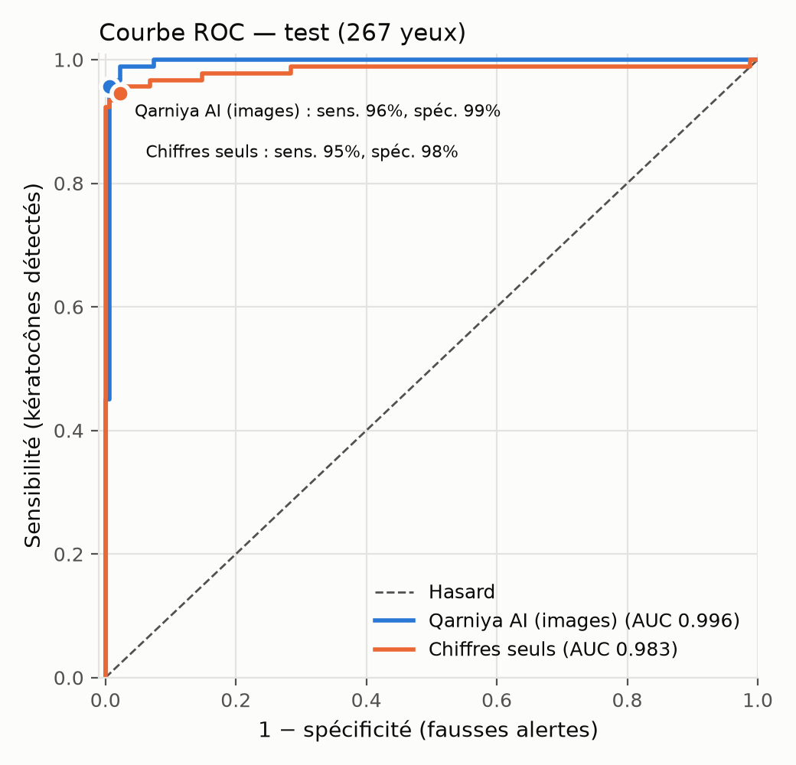

# Qarniya AI

[](https://github.com/Loqmanmk/qarniya-ai/actions/workflows/ci.yml)


**Aide au dépistage précoce du kératocône à partir des cartes de topographie cornéenne.**
Équipe NeuroLens · Hackathon Nexus HealthTech 2026 · EHEIM Oujda

> ⚠️ Outil d'aide à la décision, non certifié comme dispositif médical. Il ne pose pas de diagnostic :
> la décision reste celle de l'ophtalmologue.

## Le problème
Le kératocône déforme la cornée de jeunes patients. Un traitement (cross-linking) **freine** son évolution, mais
seulement s'il est détecté **tôt**. Les formes débutantes sont discrètes et la lecture des cartes de topographie
demande une expertise rare. Et un kératocône non détecté avant une chirurgie LASIK peut avoir des conséquences graves.

## Ce que fait Qarniya AI
À partir des **4 cartes** d'un œil (courbure axiale, élévation antérieure, élévation postérieure, pachymétrie) :

| | |
|---|---|
| 🎯 **Score et niveau** | probabilité de kératocône → faible / à surveiller / élevé |
| 🔥 **Explication** | carte de chaleur + **part de chaque carte** dans la décision |
| 🔢 **Deuxième avis** | avis des chiffres (Kmax, épaisseur) ; un **désaccord** → « à surveiller » |
| 🛑 **« Je ne sais pas »** | refus des images inexploitables, alerte « score non fiable » si l'image est inhabituelle |
| 📈 **Progression** | comparaison de deux examens du même œil |
| 📄 **Rapport PDF** | une page pour le dossier patient, anonyme, avec la signature du médecin |

## Résultats (jeu de test : 267 yeux jamais vus, 143 patients)
| | AUC | Sensibilité | Spécificité | KC manqués | Fausses alertes |
|---|---|---|---|---|---|
| **Qarniya AI** | **0,996** | **95,6 %** [90,9–98,9] | **99,4 %** | 4 / 91 | 1 / 176 |
| Chiffres seuls | 0,983 | 94,5 % [89,3–98,8] | 97,7 % | 5 / 91 | 4 / 176 |

Seuil choisi sur la validation, fourchettes à 95 % par patient. **Limites importantes** (un seul appareil, pas de formes
suspectes, une seule population) : voir la [fiche du modèle](docs/MODEL_CARD.md).



## Démarrer

**Avec Docker** (rien d'autre à installer) :
```powershell
$env:QARNIYA_RUN = "./outputs/runs/<run>"; docker compose up --build
```
**Ou en Python** (Windows / PowerShell) :
```powershell
python -m venv .venv
.\.venv\Scripts\Activate.ps1
pip install torch==2.6.0 torchvision==0.21.0 --index-url https://download.pytorch.org/whl/cu124
pip install -e ".[dev,serve,train]"
pre-commit install
```
Puis, avec les données CornOrb dans `data/cornorb/` :
```powershell
qarniya train configs/experiments/cornorb_resnet18.yaml   # entraîner
qarniya evaluate outputs/runs/<run>                        # évaluer (une seule fois)
qarniya prepare outputs/runs/<run>                         # détecteur + avis des chiffres
qarniya serve outputs/runs/<run> --port 8765               # → http://127.0.0.1:8765
```

## Ingénierie
| | |
|---|---|
| Architecture | couches **domaine → services → interfaces**, domaine pur Python **vérifié par un test** |
| Données | changer de dataset = **un fichier YAML** (adaptateurs) ; découpage par patient, contrôle des fuites |
| Qualité | ruff (+ règles de sécurité Bandit), mypy strict, **138 tests**, pre-commit, CI GitHub |
| Sécurité | pip-audit, Dependabot, CI en lecture seule, uploads vérifiés, CSP, Docker non-root en lecture seule — voir [SECURITY.md](SECURITY.md) |
| Reproductibilité | graine fixe, configuration et commit Git enregistrés avec chaque modèle |

Avant chaque push : `python scripts/check.py` lance exactement les vérifications de la CI.

## Organisation du dépôt
```
src/qarniya/
  domain/          le cœur métier (examen, cartes, risque, progression, deux avis)
  data/            adaptateurs de datasets, découpage, contrôle qualité
  models/          réseau multi-cartes, prédiction, détecteur d'images inhabituelles
  training/        entraînement piloté par configuration, callbacks
  evaluation/      métriques, seuil, bootstrap, baseline, figures
  explainability/  Grad-CAM et rendu
  services/        analyse, progression, avis des chiffres, rapport PDF
  api/             API FastAPI + interface web (static/)
configs/           YAML des datasets et des expériences
tests/             tests unitaires et d'intégration
docs/              cadrage, architecture, résultats, fiche du modèle, questions du jury
prototype/         premier prototype (référence, non maintenu)
```

## Documentation
| Document | Contenu |
|---|---|
| [01 · Cadrage](docs/01_cadrage.md) | problème, utilisateurs, objectifs, contraintes |
| [02 · Architecture](docs/02_architecture.md) | couches, principes, journal des décisions (ADR) |
| [03 · Données](docs/03_donnees.md) | adaptateurs, découpage par patient, anomalies trouvées |
| [04 · Modèle](docs/04_modele_entrainement.md) | réseau, entraînement, suivi TensorBoard |
| [05 · Évaluation](docs/05_evaluation.md) | protocole, résultats, erreurs, fusion |
| [06 · Garde-fous](docs/06_explicabilite_garde_fous.md) | carte de chaleur, contrôle qualité, images inhabituelles |
| [07 · Application](docs/07_api_interface.md) | API, interface, sécurité |
| [08 · PDF et Docker](docs/08_rapport_docker.md) | rapport, déploiement durci |
| [**Fiche du modèle**](docs/MODEL_CARD.md) | usage prévu, données, performances, **limites** |
| [Sécurité](SECURITY.md) | données de santé, mesures, vulnérabilités connues |

## Données
CornOrb — Lazouni M.E.A. et al., Zenodo 2025, DOI [10.5281/zenodo.17121301](https://doi.org/10.5281/zenodo.17121301),
licence CC BY 4.0. Les données ne sont jamais versionnées dans Git.
