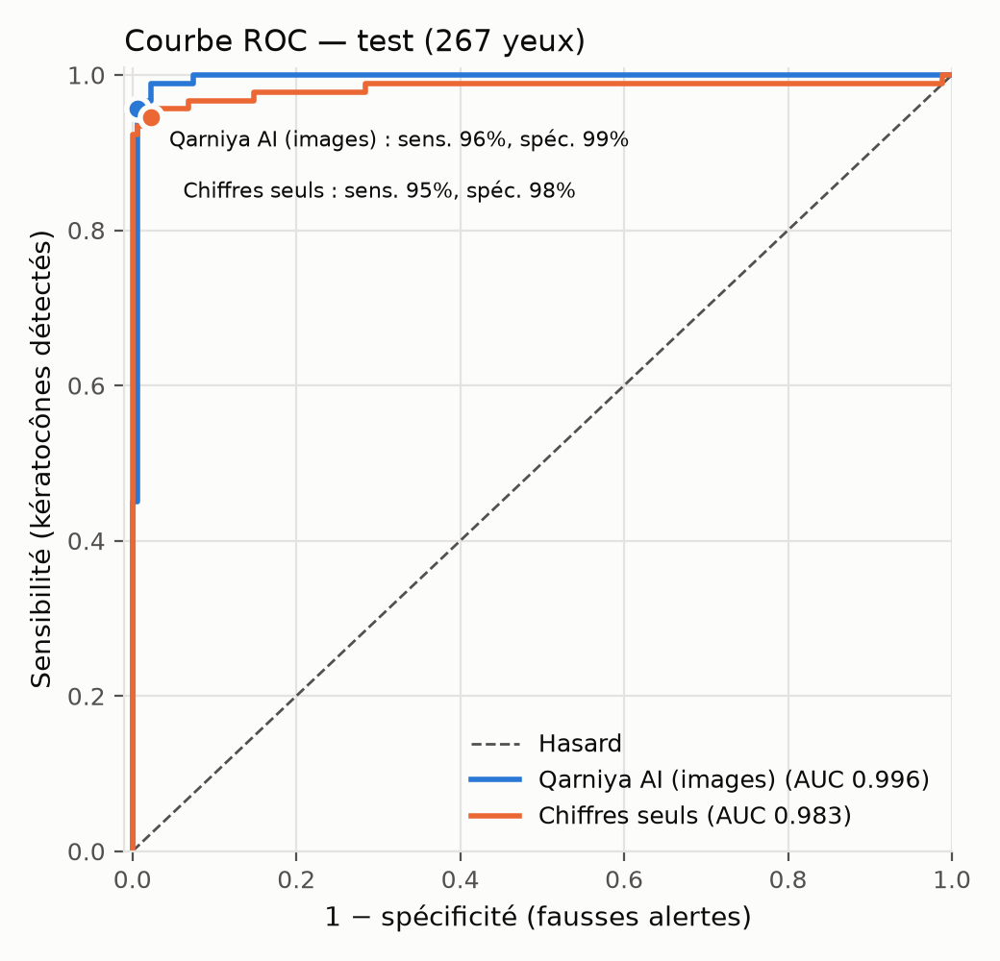
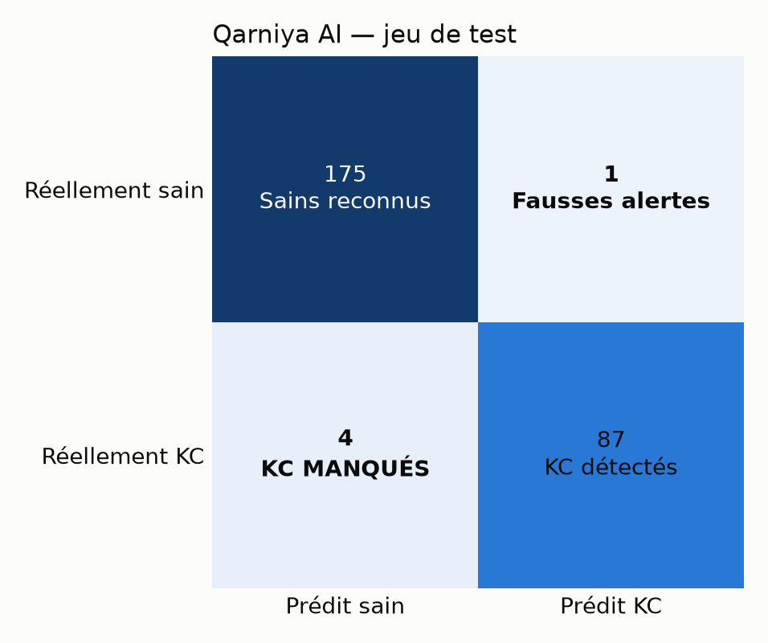

# Étape 5 — Évaluation sur le jeu de test

```powershell
qarniya evaluate outputs/runs/20261118_195456_cornorb_resnet18
```

## 1. Le protocole (fixé AVANT de regarder le test)

| Règle | Pourquoi |
|---|---|
| Le **test** (267 yeux, 143 patients) n'a jamais servi à l'entraînement ni à aucun choix | sinon le score serait optimiste |
| Le **seuil** de décision est choisi sur la **validation** pour viser **95 % de sensibilité**, puis appliqué tel quel | en dépistage, ne pas manquer de malade passe avant tout |
| La **baseline « chiffres seuls »** suit exactement le même protocole | comparaison équitable |
| **Fourchettes à 95 %** par bootstrap (2 000 tirages) **par patient** | un chiffre seul cache l'incertitude ; les 2 yeux d'un patient ne sont pas indépendants |
| Le test n'est évalué **qu'une fois** : une 2e évaluation exige `--force` | empêche de « régler le modèle sur le test » sans s'en rendre compte |

## 2. Résultats (18/11/2026)

| Modèle | AUC | Sensibilité | Spécificité | KC manqués | Fausses alertes |
|---|---|---|---|---|---|
| **Qarniya AI (4 cartes)** | **0,996** [0,987–1,000] | **95,6 %** [90,9–98,9] | **99,4 %** [98,2–100] | **4** / 91 | **1** / 176 |
| Chiffres seuls (Kmax, épaisseurs, astigmatisme, asphéricités) | 0,983 [0,957–0,999] | 94,5 % [89,3–98,8] | 97,7 % [94,6–100] | 5 / 91 | 4 / 176 |

 

### Ce qu'on peut affirmer honnêtement
- ✅ L'objectif de **sensibilité ≥ 95 %** est atteint sur des yeux jamais vus (95,6 %), avec seulement **1 fausse alerte sur 176**.
- ✅ Le modèle sur images fait **au moins aussi bien** que les chiffres de l'appareil, avec **4 fois moins de fausses alertes** (1 contre 4).
- ⚠️ Les fourchettes se **chevauchent** : sur 267 yeux, on ne peut **pas** affirmer que les images sont *statistiquement* meilleures que les chiffres. Il faudrait plus de données.
- ⚠️ CornOrb ne contient pas de **cas suspects** (formes débutantes) : ce sont précisément les cas difficiles, non mesurés ici.

## 3. Analyse des erreurs (5 sur 267)

| Œil | Vrai diagnostic | Prob. images | Prob. chiffres | Erreur | Kmax | Épaisseur min. |
|---|---|---|---|---|---|---|
| 66NY2 OS | normal | 0,9996 | 0,024 | fausse alerte | 43,7 | 517 |
| EPW8U OS | kératocône | 0,053 | **0,9997** | KC manqué | 47,1 | 445 |
| RPE81 OD | kératocône | 0,017 | 0,280 | KC manqué | 46,9 | 470 |
| ZRWCB OD | kératocône | 0,021 | **0,9988** | KC manqué | 51,1 | 481 |
| G3H95 OD | kératocône | 0,001 | **0,984** | KC manqué | 50,9 | 490 |

**Deux observations importantes :**

1. **Les erreurs sont complémentaires.** Sur les 4 kératocônes manqués par les images, **3 sont détectés par les chiffres**
   (Kmax élevé, cornée fine). Et l'unique fausse alerte des images est clairement « normale » pour les chiffres.
   → **Piste n°1 d'amélioration : combiner images + chiffres** (fusion), en suivant le même protocole (réglage sur la
   validation uniquement). On ne l'a PAS testé ici pour ne pas toucher au test.

2. **La « fausse alerte » 66NY2 OS mérite l'avis du médecin.** Sa carte axiale montre une zone plus bombée en bas
   (environ 45,5 D en inférieur contre 41,6 D en supérieur). Une telle asymétrie inférieure fait partie des signes décrits
   pour les formes débutantes. Le modèle la signale avec une quasi-certitude, et le prototype du premier jour (un autre
   entraînement) l'avait déjà signalée. Ce n'est peut-être pas une erreur du modèle mais un cas limite, voire une
   étiquette à revoir. **À montrer à notre ophtalmologue**, sans conclure nous-mêmes.

   Inversement, **G3H95 OD** (kératocône, Kmax 50,9) a une carte très bombée mais plutôt **symétrique** :
   le modèle la classe saine (0,001). Les chiffres, eux, l'attrapent.

## 4. Fichiers produits (`<run>/evaluation/`)
`metrics.json` · `report.md` · `predictions_test.csv` (toutes les prédictions) · `errors.csv` · `roc_test.png` · `confusion_test.png`

## 5. Le code

| Fichier | Rôle |
|---|---|
| `models/predictor.py` | `Predictor` : modèle sauvegardé + examens → probabilités (réutilisé par l'API) |
| `evaluation/thresholds.py` | seuil pour une sensibilité visée, placé au **milieu** d'un écart entre scores |
| `evaluation/bootstrap.py` | fourchettes de confiance **par patient** |
| `evaluation/baseline.py` | régression logistique sur les chiffres de l'appareil |
| `evaluation/figures.py` | ROC et matrice de confusion (palette lisible par les daltoniens) |
| `evaluation/runner.py` | le protocole complet + rapport |

Tests ajoutés (92 au total) : seuil vérifié à la main, fourchettes reproductibles et **plus larges par patient que par œil**
(démontré), baseline avec valeurs manquantes, figures, évaluation de bout en bout, **protection contre une 2e évaluation**.
