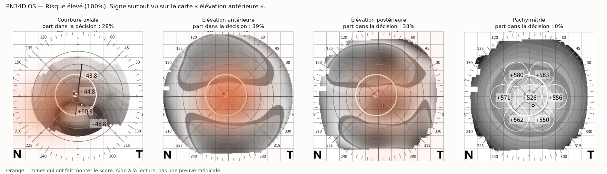
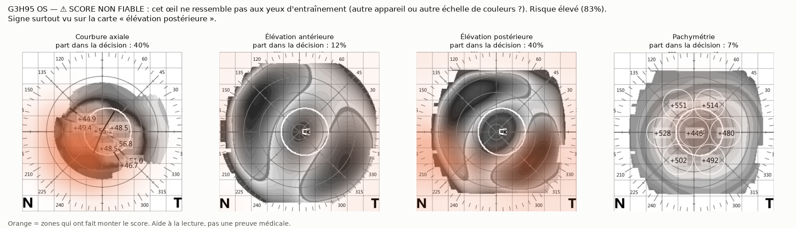
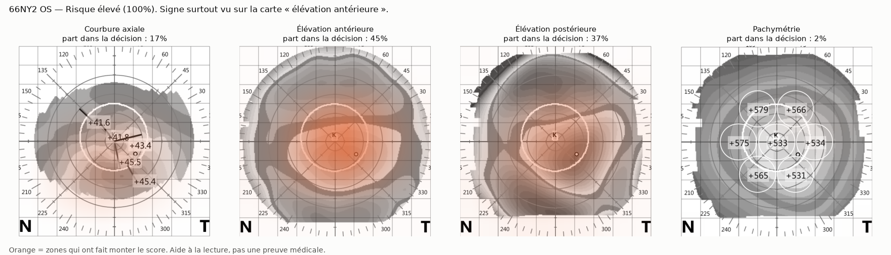

# Étape 6 — Expliquer, et savoir dire « je ne sais pas »

Un outil médical utile doit répondre à trois questions : **quel risque ?** **pourquoi ?** **puis-je te faire confiance
pour CETTE image ?** Cette étape ajoute les deux dernières.

## 1. L'analyse d'un œil : trois garde-fous avant le score

```
4 cartes ──► ① Contrôle qualité ──refus──► « Analyse impossible : pachymétrie : image sans couleurs »
                 │ ok
                 ▼
             ② Score + carte de chaleur (Grad-CAM) + part de chaque carte
                 │
                 ▼
             ③ Détecteur d'images inhabituelles ──► « ⚠ SCORE NON FIABLE : cet œil ne ressemble pas
                 │ ok                                   aux yeux d'entraînement (autre appareil ?) »
                 ▼
             « Risque élevé (100 %). Signe surtout vu sur la carte « élévation antérieure ». »
```

```powershell
qarniya fit-novelty outputs/runs/20261118_195456_cornorb_resnet18
```
```powershell
qarniya analyse outputs/runs/20261118_195456_cornorb_resnet18 configs/data/nouveaux_patients.yaml
```
→ une image par œil (`*_analyse.png`) + **`triage.csv` : la liste triée par urgence**
(d'abord les cas à revoir — refusés, inhabituels — puis risque élevé, à surveiller, faible).

## 2. La carte de chaleur (Grad-CAM)



- **Orange = zones qui ont fait monter le score.** La carte d'origine passe en gris pour ne pas mélanger ses couleurs
  (l'échelle de l'appareil) avec la chaleur ; une seule teinte, lisible par les daltoniens.
- **Part de chaque carte dans la décision** : ici élévation antérieure 39 %, postérieure 33 %, axiale 28 %,
  pachymétrie 0 %. Le médecin sait **quelle carte regarder en premier**.
- La phrase « signe surtout vu sur… » n'apparaît que si le risque n'est pas faible : la chaleur montre ce qui fait
  **monter** le score, elle n'a pas de sens pour un œil sain.
- ⚠️ **Limite** : la chaleur est calculée sur une grille de 8×8 (dernière couche du réseau), elle est donc **floue**,
  et déborde parfois hors de la cornée. C'est une **aide à la lecture, pas une preuve médicale** (écrit sur chaque figure).

## 3. Contrôle qualité (refus)
Une carte est refusée si elle est illisible, minuscule, de proportions anormales, vide/uniforme, ou **sans couleurs**
(nouveau : saturation moyenne < 0,05 ; les vraies cartes CornOrb sont toutes ≥ 0,099, médiane 0,53).
**0 carte CornOrb refusée** ; une photo ou un scan en noir et blanc est refusé.

## 4. Le détecteur d'images inhabituelles

**Le problème :** un réseau de neurones donne **toujours** un score, même pour une image qui ne ressemble à rien de ce
qu'il connaît (autre appareil, autre échelle de couleurs). Ce score est alors sans valeur, mais il a l'air sérieux.

**La solution :** chaque œil a une « empreinte » (2 048 nombres calculés par le réseau). Pour un nouvel œil, on mesure la
distance aux 5 yeux d'entraînement les plus proches. Au-delà de la distance de 99 % des yeux de **validation**, l'image
est déclarée **inhabituelle** et le score affiché comme **non fiable**.

**Mesures (le détecteur n'a jamais vu le test) :**

| Images | Signalées | Décision du modèle changée | … dont signalées |
|---|---|---|---|
| Vrais yeux de test (même appareil) | 5 / 267 (1,9 %) | — | — |
| Échelle de couleurs décalée de 60° (autre appareil simulé) | 30 / 60 (50 %) | 3 | **3** |
| … décalée de 120° | 13 / 60 (22 %) | 0 | 0 |
| … décalée de 180° | 59 / 60 (98 %) | 40 | **39** |

→ **Sur 43 cas où le changement d'appareil simulé trompe le modèle, 42 sont signalés.**
→ Quand le détecteur ne signale pas (120°), le modèle ne se trompe pas : le score reste fiable.
⚠️ Simulation seulement (rotation des couleurs) : à confirmer avec de vraies images Pentacam / Sirius.

**Un cas réel signalé :** G3H95 OS, kératocône **très avancé** (Kmax 58,8 D, astigmatisme −9,4 D, épaisseur 434 µm,
une partie de la carte non mesurée). Il ne ressemble à aucun œil d'entraînement : l'outil le signale, tout en donnant un
risque élevé (83 %). C'est le comportement attendu : **en cas de doute, on renvoie vers le médecin**.



**Et 66NY2 OS**, la « fausse alerte » de l'étape 5 : la chaleur se concentre sur l'élévation, là où l'asymétrie
inférieure est visible. Cas à soumettre à notre ophtalmologue.



## 5. Le code

| Fichier | Rôle |
|---|---|
| `explainability/gradcam.py` | Grad-CAM + part de chaque carte ; remet l'œil gauche dans son sens d'origine |
| `explainability/rendering.py` | superposition (gris + une teinte), figure à 4 panneaux |
| `models/novelty.py` | détecteur d'images inhabituelles (sauvegarde `.npz`, aucun code exécutable) |
| `models/multimap.py` | nouvelle méthode `embed` (empreinte de l'œil) |
| `data/validation.py` | nouveau contrôle « sans couleurs » |
| `services/analysis.py` | **le service d'analyse** : qualité → score + chaleur → nouveauté ; tri par urgence |
| `domain/enums.py` | libellés affichés (« à surveiller », « élevé ») distincts des codes internes |

Tests : 107 au total — chaleur normalisée et retournée pour l'œil gauche, importance qui somme à 1, superposition,
détecteur (≈ 1 % de la calibration signalé, points lointains signalés, sauvegarde), refus d'une carte grise **sans aucun
score**, branche « non fiable », tri, commandes `fit-novelty` et `analyse` de bout en bout.
