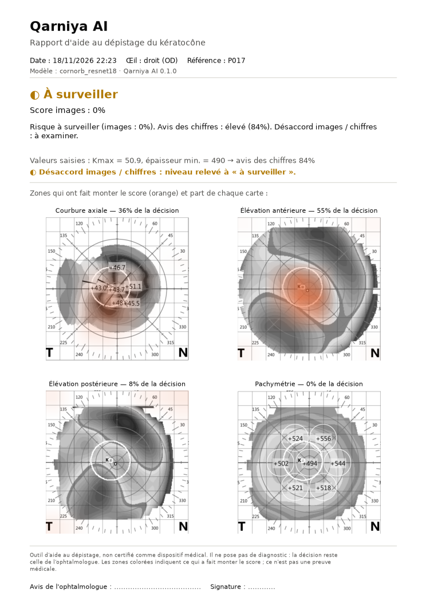

# Étape 8 — Rapport PDF et déploiement Docker

## 1. Le rapport PDF (dossier patient)

Bouton **« ⬇ Rapport PDF »** dans l'interface, ou `POST /api/reports` (mêmes champs que l'analyse + `reference`).



Une page A4 : niveau (icône + couleur + texte), score, explication, valeurs saisies et avis des chiffres,
**désaccord mis en évidence**, les 4 cartes avec la chaleur et la part de chaque carte, l'avertissement légal,
et une zone **« Avis de l'ophtalmologue / Signature »** : le médecin garde la décision, par écrit.

**Confidentialité (loi 09-08)** : le rapport ne contient **aucune identité**. Le médecin peut ajouter une
**référence anonyme** (ex. `P017`) : lettres, chiffres, `-` et `_`, 24 caractères maximum. Un nom (« Fatima Zahra »),
une date de naissance ou un texte suspect (`../../etc`) sont **refusés** (erreur 422, testé).
Le PDF est fabriqué en mémoire et envoyé : **rien n'est conservé** sur le serveur.

Fabriqué avec matplotlib (déjà dans le projet) : **aucune nouvelle dépendance**.

## 2. Docker : l'outil en une commande, sur n'importe quel PC

```powershell
docker build -t qarniya-ai .
```
```powershell
$env:QARNIYA_RUN = "./outputs/runs/20261118_195456_cornorb_resnet18"; docker compose up --build
```
→ http://127.0.0.1:8765

Ou sans compose :
```powershell
docker run --rm -p 127.0.0.1:8765:8000 -v "${PWD}\outputs\runs\20261118_195456_cornorb_resnet18:/model:ro" qarniya-ai
```

### Choix de conception
| Choix | Pourquoi |
|---|---|
| PyTorch **CPU** dans l'image | fonctionne partout, même sans carte graphique (une analyse prend ~1 s) |
| Le **modèle n'est pas dans l'image**, il est monté en lecture seule (`/model:ro`) | changer de modèle sans reconstruire ; aucune donnée de santé dans l'image |
| `.dockerignore` en **liste blanche** | seuls `pyproject.toml`, `README.md` et `src/` entrent dans l'image (jamais `data/`, `.venv`, secrets) |
| Couche PyTorch **avant** le code | reconstruire après une modification du code prend quelques secondes (cache) |
| `HEALTHCHECK` | Docker sait si l'application répond (`healthy`) et peut la redémarrer |

### Durcissement (docker-compose.yml)
| Mesure | Effet |
|---|---|
| utilisateur **non-root** (uid 10001) | une faille dans l'application ne donne pas les droits administrateur |
| `read_only: true` + `/tmp` en **mémoire** (tmpfs) | rien ne peut être écrit sur le disque ; les images analysées n'y arrivent jamais |
| `cap_drop: [ALL]`, `no-new-privileges` | aucun privilège Linux, impossible d'en gagner |
| port publié sur **127.0.0.1** | accessible depuis ce PC seulement |

### Vérifié pour de vrai (Docker 29, 18/11/2026)
- conteneur durci démarré : santé `healthy`, utilisateur `uid=10001(qarniya)` ;
- analyse de G3H95 OD **dans le conteneur** : même résultat que sur le PC (« à surveiller », désaccord détecté) ;
- rapport PDF téléchargé (HTTP 200, `application/pdf`) ;
- `docker diff` : **aucun fichier écrit** dans le conteneur ;
- la CI GitHub construit l'image à chaque push et vérifie qu'elle ne tourne pas en root.

## 3. Nettoyage au passage
- **OpenCV supprimé** : hérité du prototype, plus utilisé par le code (Pillow suffit). Image plus légère, moins de
  bibliothèques système, moins de surface d'attaque. Les 138 tests passent sans lui.
- **TensorBoard** déplacé dans l'extra `train` : utile pour entraîner, inutile pour servir l'outil.

```powershell
pip install -e ".[serve]"              # utiliser l'outil
pip install -e ".[dev,serve,train]"    # développer et entraîner
```
